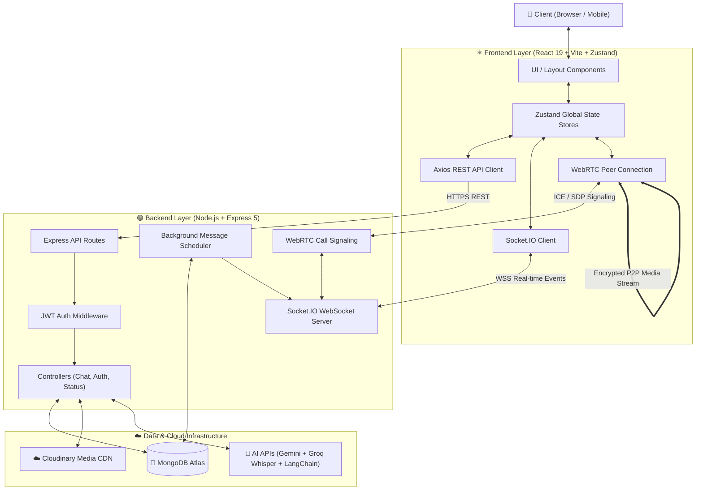
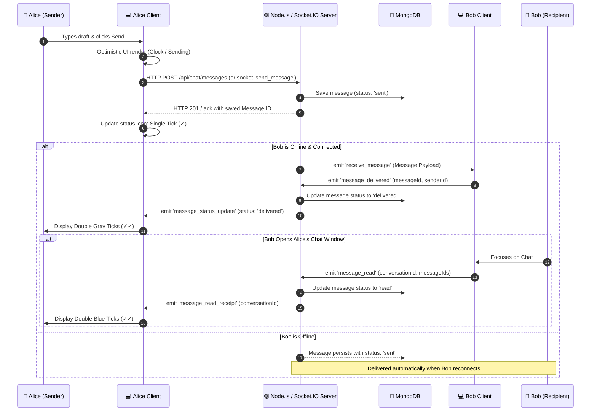
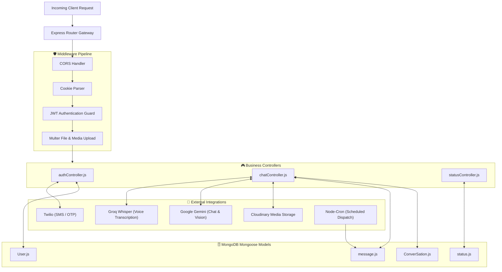
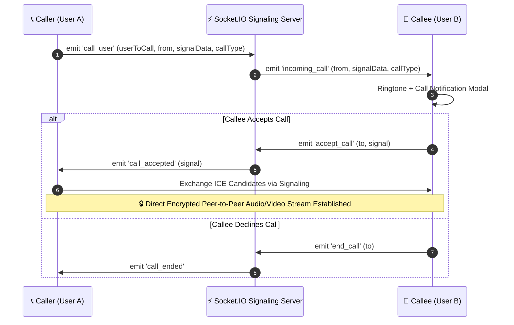
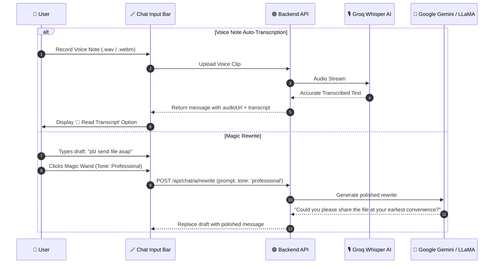

# 💬 WhatsApp Clone (MERN + Socket.IO + Meta AI)

<p align="center">
  
</p>

<p align="center">
  
</p>

---

## 🏆 Badges

<p align="center">
  
  
  
  
  
  
</p>

---

## 🌍 Live Demo & Repository

- 🚀 **Live Application:** [https://whatsapp-gilt-alpha.vercel.app](https://whatsapp-gilt-alpha.vercel.app)
- 💻 **GitHub Repository:** [https://github.com/suvojitmanna/whatsApp_clone](https://github.com/suvojitmanna/whatsApp_clone)

---

## 🧠 Project Overview

A production-grade, highly scalable real-time communication platform inspired by **WhatsApp Web (2026 Edition)**. Built on the **MERN** stack, it delivers ultra-low-latency messaging via **Socket.IO**, peer-to-peer audio/video calling using **WebRTC**, intelligent messaging tools powered by **Meta AI & Groq Whisper**, 4-digit PIN secret locked chats, and rich media sharing backed by Cloudinary.

### ✨ Core Highlights
* ⚡ **Real-time Bi-directional Messaging**: Instant message delivery with live typing indicators and read receipts (`Sent` ➔ `Delivered` ➔ `Read` double blue ticks).
* 🟢 **Live User Presence Tracking**: Accurate online/offline status with "Last Seen" updates.
* 🤖 **Meta AI & Agentic Suite**: In-chat AI assistant, `/imagine` image generation, 🪄 Magic Rewrite (Professional, Friendly, Concise, Grammar), Groq Whisper audio transcription, and real-time live chat translation.
* 🔒 **High-Grade Privacy & Security**: Visual 60-digit and QR End-to-End Encryption verification, Secret PIN Locked Chats with biometric simulation, and disappearing message timers.
* 📞 **HD Voice & Video Calling**: WebRTC-powered 1-on-1 and group calls with shareable meeting links and call controls.
* 📸 **Status (Stories)**: 24-hour disappearing photo, video, and text status updates with viewers analytics.
* ⏰ **Scheduled Messages ("Send Later")**: Schedule messages for any future date/time with automatic background dispatching.
* 📊 **Interactive In-Chat Cards**: Real-time multi-choice Polls and Event invitations with live RSVP tracking.

<p align="center">
  
</p>

---

## 🖼️ Demo Preview

<p align="center">
  
</p>

---

## 🧠 System Design & Architecture Diagrams

### 1. High-Level System Architecture


---

### 2. Real-Time Message Flow & Delivery Lifecycle


---

### 3. Frontend Component & Store Architecture

```mermaid
flowchart LR
    subgraph UIComponents["🎨 Presentation Layer"]
        Layout["Layout & Left Rail"]
        ChatList["Chat List & Search"]
        ChatWindow["Active Chat Window"]
        ContactInfo["Contact Info Drawer"]
        Modals["Modals (AI, PIN, Poll, Call)"]
    end

    subgraph StateStores["⚡ Zustand Reactive State Layer"]
        UserStore["useUserStore (Auth & Profile)"]
        ChatStore["chatStore (Chats, Messages, Typing)"]
        CallStore["useCallStore (WebRTC Audio/Video)"]
        ThemeStore["useThemeStore (Light / Dark)"]
        StatusStore["statusStore (24h Stories)"]
    end

    subgraph NetworkClients["📡 Network Client Layer"]
        AxiosAPI["Axios (HTTP / Interceptors)"]
        SocketIO["Socket.IO (Event Listeners & Emitters)"]
        PeerConn["RTCPeerConnection (Media Stream)"]
    end

    UIComponents <--> StateStores
    StateStores <--> NetworkClients
    NetworkClients <-->|REST API + WebSockets| ServerGateway["🟢 Backend API Gateway"]
```


---

### 4. Backend Service Architecture


---

### 5. WebRTC Peer-to-Peer Calling Flow


---

### 6. Meta AI Magic Rewrite & Voice Transcription Flow


---

## 🧩 Project Structure

```text
whatsApp_clone/
├── client/                          # React 19 Frontend (Vite 8)
│   ├── src/
│   │   ├── components/
│   │   │   ├── common/              # Avatars, buttons, loaders, custom icons
│   │   │   ├── contactInfo/         # Contact & group settings drawer
│   │   │   ├── info/                # Modern WhatsApp Help Center & Privacy
│   │   │   ├── layout/              # SideBar navigation rail & Layout container
│   │   │   ├── media/               # Waveform audio player, media gallery
│   │   │   ├── modals/              # AI, WebRTC Call, PIN Lock, Poll, Event modals
│   │   │   └── panels/              # Message info, Poll analytics panels
│   │   ├── pages/
│   │   │   ├── calls/               # Call logs, Dialpad, Shareable Call Links
│   │   │   ├── chatSection/         # Chat list, Message bubbles, Input bar
│   │   │   ├── helpPage/            # Help Center topics, FAQs & 24/7 Support
│   │   │   ├── mediaSection/        # Media, links & document explorer
│   │   │   ├── SettingSection/      # Profile, Chat Lock PIN, Notifications, Themes
│   │   │   ├── statusSection/       # 24-hour disappearing Stories & creator
│   │   │   ├── user-login/          # Authentication & onboarding flow
│   │   │   └── videoCall/           # Fullscreen WebRTC Audio/Video call room
│   │   ├── store/                   # Zustand state stores (User, Chat, Call, Theme)
│   │   └── utils/                   # Formatting helpers, audio recorder, socket client
│   ├── package.json
│   └── vite.config.js
│
├── server/                          # Node.js + Express 5 Backend
│   ├── config/                      # MongoDB connection & Cloudinary setup
│   ├── controllers/                 # authController.js, chatController.js, statusController.js
│   ├── middleware/                  # JWT auth verification, Multer upload
│   ├── models/                      # User.js, ConverSation.js, message.js, status.js
│   ├── routes/                      # authRoute.js, chatRoute.js, statusRoute.js
│   ├── socket/                      # Socket.IO connection handlers & WebRTC signaling
│   ├── index.js                     # Server entrypoint
│   └── package.json
│
└── README.md                        # Documentation & Architecture Guide
```

---

## ⚙️ Installation & Setup

### 1. Clone the Repository
```bash
git clone https://github.com/suvojitmanna/whatsApp_clone.git
cd whatsApp_clone
```

### 2. Configure Environment Variables

#### Backend Configuration (`server/.env`):
```env
# Server Port & MongoDB
PORT=5000
MONGO_URI=your_mongodb_atlas_connection_string

# Authentication & CORS
JWT_SECRET=your_super_secret_jwt_key
FRONTEND_URL=http://localhost:5173

# Cloudinary Media Storage
CLOUDINARY_CLOUD_NAME=your_cloudinary_cloud_name
CLOUDINARY_API_KEY=your_cloudinary_api_key
CLOUDINARY_API_SECRET=your_cloudinary_api_secret

# AI & Speech Services
GEMINI_API_KEY=your_google_gemini_api_key
GEMINI_MODEL=gemini-1.5-flash
GROQ_API_KEY=your_groq_api_key
GROQ_MODEL=whisper-large-v3
META_AI_MODEL=llama-3.3-70b-versatile
```

#### Frontend Configuration (`client/.env`):
```env
VITE_API_URL=http://localhost:5000
```

---

### 3. Install Dependencies & Run

#### Backend:
```bash
cd server
npm install
npm run dev
```
*Server runs on `http://localhost:5000`*

#### Frontend:
```bash
cd ../client
npm install
npm run dev
```
*Vite client runs on `http://localhost:5173`*

---

## 🔗 Key API Endpoints

| Method | Endpoint | Description |
| :--- | :--- | :--- |
| `POST` | `/api/auth/register` | Register a new user |
| `POST` | `/api/auth/login` | Authenticate user & issue JWT cookie |
| `GET` | `/api/auth/me` | Fetch authenticated user profile |
| `GET` | `/api/chat/conversations` | Retrieve all active user chats & groups |
| `POST` | `/api/chat/messages` | Send message (Text, Media, Audio, Scheduled) |
| `GET` | `/api/chat/messages/:id` | Fetch conversation messages |
| `POST` | `/api/chat/messages/react` | Add or update emoji reaction |
| `POST` | `/api/chat/ai/rewrite` | AI Magic message rewrite |
| `POST` | `/api/status` | Create new 24h status story |
| `GET` | `/api/status` | Fetch contacts status stories |

---

## 📡 Socket.IO Real-Time Events Reference

| Event Name | Direction | Purpose |
| :--- | :--- | :--- |
| `join_chat` | Client ➔ Server | Join private conversation or group channel |
| `send_message` | Client ➔ Server | Broadcast new chat message |
| `receive_message` | Server ➔ Client | Receive new incoming message |
| `typing` / `stop_typing` | Both | Trigger real-time typing state indicator |
| `message_read` | Client ➔ Server | Send blue-tick read receipts |
| `call_user` | Client ➔ Server | Initiate WebRTC audio/video call |
| `incoming_call` | Server ➔ Client | Prompt callee with call modal & ringtone |
| `accept_call` / `end_call` | Both | WebRTC session acceptance & termination |
| `user_status` | Server ➔ Client | Broadcast online/offline presence |

---

## 📊 GitHub Insights & Statistics

<p align="center">
  
  
</p>

<p align="center">
  
</p>

<p align="center">
  
</p>

---

## 🤝 Contributing

Contributions are welcome! Please follow these steps:
```bash
# 1. Fork the Project
# 2. Create your Feature Branch
git checkout -b feature/AmazingFeature

# 3. Commit your Changes
git commit -m "Add some AmazingFeature"

# 4. Push to the Branch
git push origin feature/AmazingFeature

# 5. Open a Pull Request
```

---

## ⭐ Support & Acknowledgments

If you found this project helpful or inspiring, please consider giving it a **star**! ⭐

- ⭐ **Star** the repository on [GitHub](https://github.com/suvojitmanna/whatsApp_clone)
- 🍴 **Fork** it to build your own custom real-time features
- 📢 **Share** it with your developer community

---

## 👨‍💻 Author

**Suvojit Manna**
- 🌐 **Portfolio / Live App:** [https://whatsapp-gilt-alpha.vercel.app](https://whatsapp-gilt-alpha.vercel.app)
- 🐙 **GitHub:** [@suvojitmanna](https://github.com/suvojitmanna)

---

## 📜 License

Distributed under the **MIT License**. See `LICENSE` for more information.

---

## 👁️ Profile Views
<p align="center">
  
</p>

<p align="center">
  
</p>
